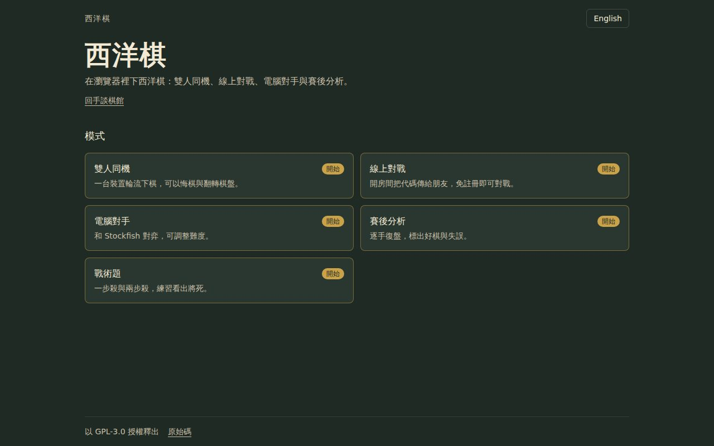
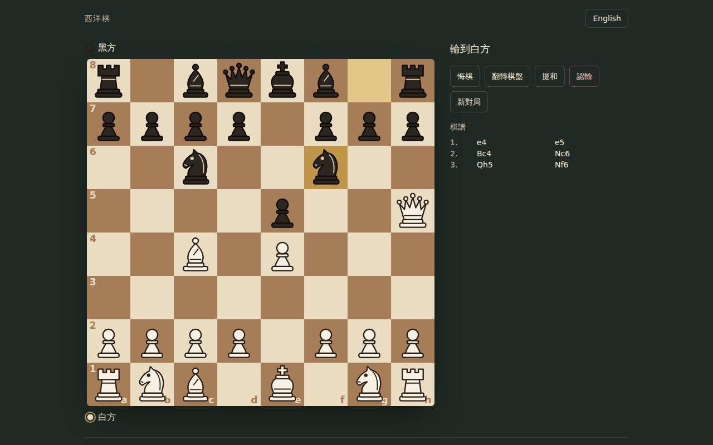
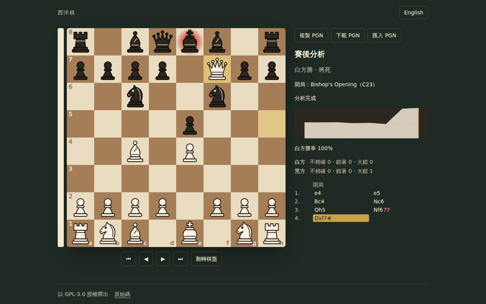
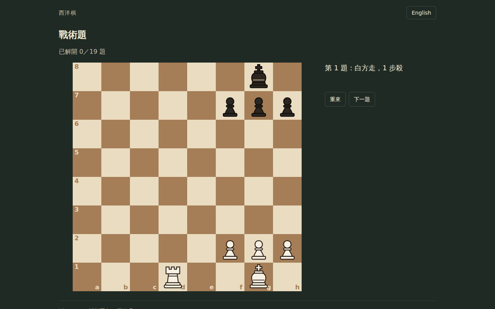

# 西洋棋 ChessTorusGamets

在瀏覽器裡下西洋棋的網頁遊戲：雙人同機、線上對戰、電腦對手與賽後分析。
規則與引擎都在瀏覽器裡執行，線上對戰使用 Firebase，不需要自建伺服器；安裝成 PWA 後可以離線遊玩。









## 功能

- **雙人同機**：一台裝置輪流下。
  - 點選或拖曳走子、升變選子、翻轉棋盤。
  - 可以悔棋（不計時時）、提和、認輸、聲明和棋。
  - 可選時制；重新整理後接著下。
- **線上對戰**：開房間後分享連結或房號，或從大廳加入公開房間；匿名登入、免註冊。
  - 可以觀戰、提和、聲明和棋、認輸。
  - 結束後可以再來一局（交換先後手）。
- **電腦對手**：Stockfish.js（lite 單執行緒）在 Web Worker 中執行。
  - 八個難度，可以要求提示；可選時制（計時時不能悔棋）。
  - 開局使用 Lichess 的開局資料，讓每盤有變化。
- **賽後分析**：任何模式下完的對局都能分析。
  - 勝率走勢圖、評估條、引擎推薦手的箭頭。
  - 每手的判斷：不精確 ?!、錯著 ?、大錯 ??。
  - 顯示開局名稱，可以用方向鍵逐手瀏覽。
- **PGN**：賽後分析可以複製、下載 PGN，也能貼上 PGN 匯入分析。
- **戰術題**：一步殺與兩步殺，同一題的其他正解也算對，進度存在瀏覽器。
- **線上對局進行中不提供任何引擎協助**，對局結束後才能分析。
- **勝負與和棋依 FIDE 正式比賽規定**：
  - 自動結束：將死、逼和、死局面、五次重複、75 回合、超時。
  - 需要聲明：三次重複、50 回合，由輪到走棋的一方聲明。
- **PWA**：可以安裝到主畫面；除了線上對戰，其他功能都能離線使用。
- **繁體中文與英文介面**。

## 快速開始

需要 Node.js 22.18 以上。

```bash
npm install
```

```bash
npm run dev
```

開發伺服器預設在 <http://localhost:5173/>。

## 指令

| 指令                                      | 用途                                                |
| ----------------------------------------- | --------------------------------------------------- |
| `npm run dev`                             | 開發伺服器                                          |
| `npm run build`                           | 正式版建置到 `dist/`（含引擎、Service Worker）      |
| `npm run preview`                         | 預覽 `dist/`                                        |
| `npm run typecheck`                       | TypeScript 型別檢查                                 |
| `npm run format`                          | Prettier 排版                                       |
| `npm run format:check`                    | 檢查排版                                            |
| `npm test`                                | 單元測試（node:test，含真的 Stockfish 引擎）        |
| `npm run test:e2e`                        | 端對端測試（Playwright），會自動建置 e2e 版         |
| `npm run check`                           | 型別、排版、單元測試、建置一次跑完                  |
| `npm run smoke -- <網址>`                 | 部署後驗收（見「部署」）                            |
| `npm run generate:icons`                  | 由 `public/icons/icon.svg` 重新產生 PNG 圖示        |
| `npm run generate:openings -- <tsv 目錄>` | 由 Lichess `chess-openings` 的 TSV 重新產生開局資料 |

第一次跑端對端測試前要安裝瀏覽器：

```bash
npx playwright install chromium
```

## 技術

- React 19、Vite、TypeScript、Tailwind CSS 4。
- 規則：chess.js，只在 `src/core/` 裡使用，畫面不直接依賴它。
- 棋盤、棋子、圖示與動畫都是自製 SVG。
- 線上對戰：Firebase Realtime Database + 匿名登入，透過 `RoomBackend` 介面隔離；規則在 `database.rules.json`。
- 引擎：Stockfish.js 19 lite 單執行緒版，在 Web Worker 中執行。
- 開局資料：Lichess `chess-openings`（CC0）。
- 測試：node:test、Playwright；GitHub Actions 在每次推送與 PR 時執行。

架構與設計見 [docs/architecture.md](docs/architecture.md)，重要決定與理由見 [docs/decisions.md](docs/decisions.md)，開發規則見 [CLAUDE.md](CLAUDE.md)。

## 設定 Firebase（線上對戰）

沒有設定時，其他模式照常運作，線上對戰會顯示「尚未設定」。這個專案要用**自己專屬的** Firebase 專案。

1. 在 [Firebase Console](https://console.firebase.google.com/) 建立專案。
2. **Authentication → 登入方式**：啟用「匿名」。
3. **Realtime Database**：建立資料庫（地區任選），記下資料庫網址。
4. 部署資料庫規則（`firebase.json` 已指向 `database.rules.json`）：

   ```bash
   npx firebase-tools deploy --only database --project <你的專案 ID>
   ```

   也可以把 `database.rules.json` 的內容貼到 Console 的「規則」分頁後發布。

5. **專案設定 → 一般 → 你的應用程式**：新增網頁應用程式，把設定值填進環境變數（名稱見 `.env.example`）：

   | 變數                         | 對應的設定值  |
   | ---------------------------- | ------------- |
   | `VITE_FIREBASE_API_KEY`      | `apiKey`      |
   | `VITE_FIREBASE_AUTH_DOMAIN`  | `authDomain`  |
   | `VITE_FIREBASE_DATABASE_URL` | `databaseURL` |
   | `VITE_FIREBASE_PROJECT_ID`   | `projectId`   |
   | `VITE_FIREBASE_APP_ID`       | `appId`       |

   本機開發時複製成 `.env.local`（已被 `.gitignore` 排除）；部署時設定在 Cloudflare Pages 的環境變數（見下一節）。

這些值會出現在每個訪客的瀏覽器裡，本身不是祕密，資料安全由 `database.rules.json` 把關；但仍然不要提交到儲存庫。

## 部署（Cloudflare Pages）

1. 在 Cloudflare 儀表板：**Workers & Pages → 建立 → Pages → 連接到 Git**，選擇這個儲存庫。
2. 建置設定：

   | 項目       | 值                                                           |
   | ---------- | ------------------------------------------------------------ |
   | 正式版分支 | `main`                                                       |
   | 框架預設   | 無（None）                                                   |
   | 建置指令   | `npm run build`                                              |
   | 輸出目錄   | `dist`                                                       |
   | Node.js    | 自動讀取 `.nvmrc`（22）                                      |
   | 環境變數   | 上一節的五個 `VITE_FIREBASE_*`（「正式版」與「預覽」都要設） |

3. 儲存並部署。之後推送到 `main` 會自動更新正式網址，其他分支會產生預覽網址。
   環境變數在建置時讀入，**改了變數要重新部署**才會生效。
4. 在 Google Cloud Console 的 API 金鑰設定裡，把 HTTP 參照網址限制加上 `https://<專案>.pages.dev/*`（以及自訂網域）。
5. 驗收：

   ```bash
   npm run smoke -- https://<專案>.pages.dev --online
   ```

   它會檢查首頁、`_headers`、manifest 與圖示、引擎、Service Worker 與離線重新整理、Firebase 設定，
   `--online` 會實際匿名登入並讀取大廳（只讀不寫）。

說明：

- 快取規則在 `public/_headers`；路由都在網址雜湊（`#/online`、`#/r/<房號>`），不需要轉址設定。
- 所有路徑都是相對路徑，部署在子目錄或自訂網域也能運作。
- 不需要 Cloudflare Worker 或其他伺服器。

## 授權

[GPL-3.0](LICENSE)。第三方套件、引擎與資料的授權見 [THIRD_PARTY_LICENSES.md](THIRD_PARTY_LICENSES.md)。
